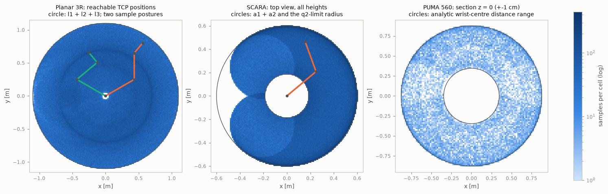
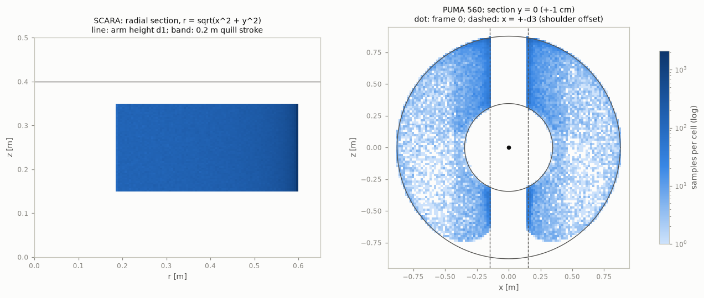
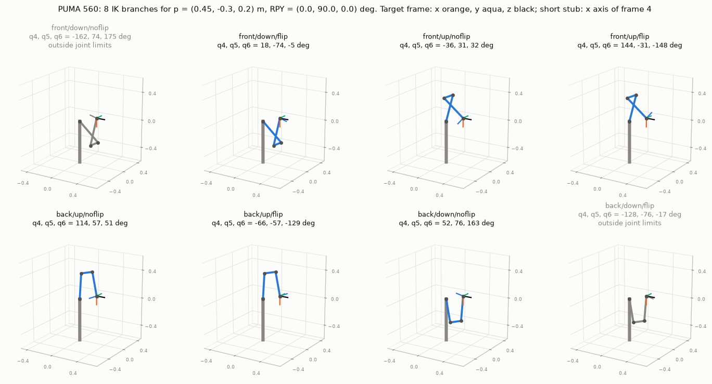
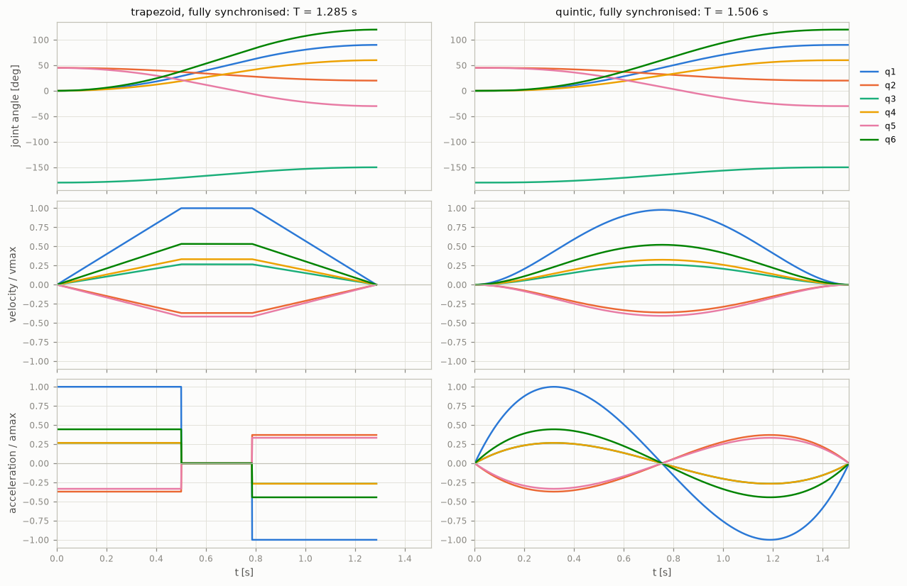
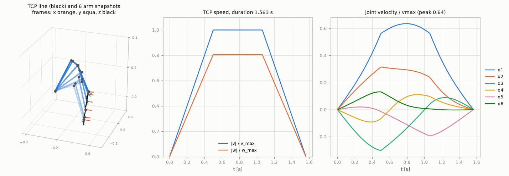
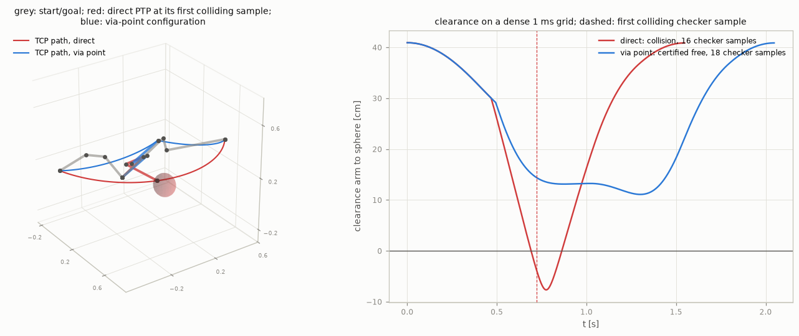
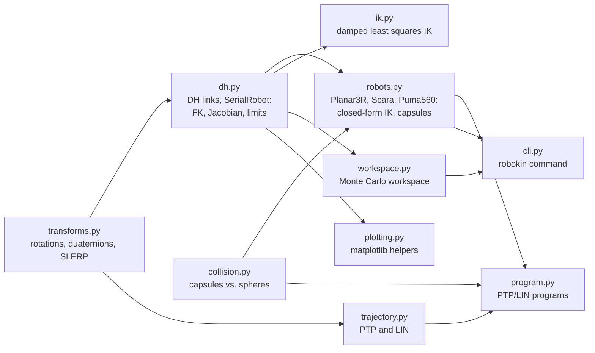
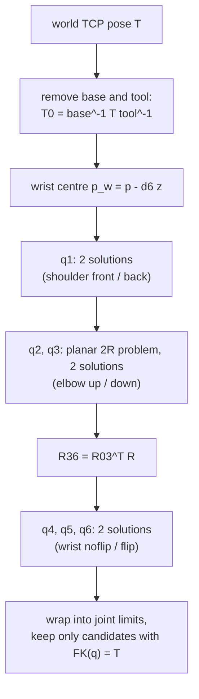

# robot-kinematics

`robokin`: forward and inverse kinematics, workspace analysis, trajectory planning and capsule collision checks for a planar 3R arm, a SCARA and a PUMA 560, in Python with NumPy.


## Context

This is a self-directed project applying the content of the module **Robotik** (Robotics, B36) of the B.Eng. Technische Informatik – Embedded Systems at BHT Berlin. The module's lab computes the workspace and the kinematics of three robots and covers robot programming and interpolation; this repository does the same for three classic arm types and adds the trajectory and collision topics from the lecture. Everything here runs in simulation only; nothing has been tested on a physical robot.

| Module topic | Where it appears |
|---|---|
| Vector calculus (Vektorrechnung) | `transforms.py` (skew matrices, cross products), Jacobian columns in `dh.py` |
| Coordinate transformation | `transforms.py`: homogeneous transforms, RPY angles, axis-angle, quaternions |
| Denavit-Hartenberg transformation | `dh.py`, the [DH tables](#robot-models) below, `robokin dh <robot>` |
| Robot kinematics | `dh.py` (FK, Jacobian), `robots.py` (closed-form IK), `ik.py` (numeric IK) |
| Robot design types (Bauformen) | `robots.py`: planar articulated arm, SCARA, 6-axis articulated arm |
| Lab: workspace and kinematics of three robots | `workspace.py`, `examples/workspace_plots.py`, `examples/ik_solutions.py` |
| Programming of robots, interpolation | `program.py` (PTP/LIN programs), `trajectory.py` |
| Trajectory planning and collision avoidance | `trajectory.py`, `collision.py`, `examples/collision_demo.py` |

## Features

- **Rotations and transforms**: rotation matrices, ZYX roll-pitch-yaw angles (with gimbal-lock handling), axis-angle / rotation vectors (Rodrigues), unit quaternions (Shepperd's method), SLERP, rigid-transform inverse.
- **Standard Denavit-Hartenberg chains**: `DHLink` and `SerialRobot` for arbitrary serial chains of revolute and prismatic joints, with base and tool transforms. Forward kinematics is vectorised over many configurations at once.
- **Three robot models**: planar 3R arm, SCARA (RRPR, after Spong et al.) and PUMA 560 (standard DH parameters from Corke's Robotics Toolbox, see [Robot models](#robot-models)).
- **Closed-form inverse kinematics** returning every branch with a label: elbow up/down for the planar arm, lefty/righty for the SCARA, and up to 8 solutions (shoulder front/back x elbow up/down x wrist flip/noflip) for the PUMA 560 via wrist-centre decoupling. Every candidate is checked by forward kinematics and shifted by multiples of 2 pi into the joint limits.
- **Numeric inverse kinematics**: damped least squares with Levenberg-Marquardt damping, two joint-limit strategies and random restarts, usable for any `SerialRobot`.
- **Jacobian analysis**: geometric Jacobian, Yoshikawa manipulability, rank-based singularity test and named singularities (shoulder, elbow, wrist for the PUMA).
- **Workspace**: Monte Carlo sampling of the joint-limit box, grid/voxel occupancy, an exact hit-or-miss volume estimate for the PUMA and a semi-analytic area reference for 2R arms; cross-section plots for all three robots.
- **Trajectories**: PTP with trapezoidal or quintic profiles in three coordination modes (asynchronous, synchronised end time, fully synchronised), LIN motion with SLERP orientation that respects translational and rotational speed and acceleration limits, tracked with the closed-form IK.
- **Collision checking**: links as capsules, spherical obstacles, exact capsule-sphere clearance, and an adaptive path check that either finds a colliding sample or *certifies* the whole motion collision-free with a displacement bound.
- **Motion programs**: a small PTP/LIN program builder in the style of an industrial teach pendant, with a whole-program collision check.
- **CLI** (`robokin dh|fk|ik|workspace`) and example scripts that produce the figures below.

### Results

All numbers below were printed by the example scripts in this repository (fixed random seeds) on the development machine.

**Workspace** (`python examples/workspace_plots.py`: 10^6 joint samples for the planar arm and the SCARA, 2 x 10^6 for the PUMA, seed 7):

| Robot | Quantity | Monte Carlo | Reference |
|---|---|---|---|
| Planar 3R | area, occupied 10 mm cells | 3.8204 m² | at most 3.8013 m² (disc of radius l1 + l2 + l3) |
| SCARA | top-view area, occupied 5 mm cells | 0.9537 m² | 0.9401 m² (radial integral, `two_link_area`) |
| SCARA | volume, occupied 20 mm voxels | 0.2180 m³ | 0.1880 m³ (area x 0.2 m stroke) |
| PUMA 560 | volume, occupied 20 mm voxels | 2.5414 m³ | 2.5185 m³ ± 0.0019 (hit-or-miss, 2 x 10^6 points) |
| PUMA 560 | wrist-centre distance from frame 0 | 0.3461 .. 0.8770 m | 0.3461 .. 0.8770 m (analytic) |

Occupancy counts every partly covered boundary cell in full, so it overestimates: the planar estimate exceeds even the area of the enclosing disc, and the effect is largest for the SCARA, whose 0.2 m tall slab straddles one extra voxel layer. With too few samples per cell the opposite bias wins (interior cells are never hit), which is why `robokin workspace` prints the mean number of samples per occupied cell and warns below 10.




**Inverse kinematics** (`python examples/ik_benchmark.py`: 200 random reachable poses per robot, seed 11):

| | Planar 3R | SCARA | PUMA 560 |
|---|---|---|---|
| closed form: source configuration among the solutions | 100 % | 100 % | 100 % |
| closed form: mean number of in-limit branches | 1.97 | 1.78 | 4.64 |
| closed form: max abs(FK(q) - T) over all branches | 1.1e-15 | 1.2e-15 | 6.8e-15 |
| DLS, clamped limits, seed within 0.1 rad / 1 cm | 100 % | 100 % | 100 % |
| DLS, clamped limits, random seed | 50.5 % | 69.5 % | 44.0 % |
| DLS, wrapped limits, random seed | 99.0 % | 88.5 % | 58.5 % |
| DLS, wrapped limits: converged to an out-of-limit branch | 1.0 % | 11.5 % | 41.0 % |
| `ik_numeric` (up to 20 restarts) | 100 % | 100 % | 99.0 % |

The two PUMA poses the restarts missed are both poses where only one of the four arm configurations lies inside the joint limits. In pure Python the closed form took 5 to 6 ms per PUMA pose and `ik_numeric` about 20 times as long (two runs on the development machine; absolute timings vary with machine load).



**Trajectories** (`python examples/trajectories.py`, illustrative joint limits): the PTP move from the nominal pose takes 1.285 s with fully synchronised trapezoids and 1.506 s with quintic polynomials; joint 1 is the leading axis in both. The LIN move (0.5 m/s, 1 rad/s) takes 1.563 s, the translational limit is the binding one (peak speed 1.000 of v_max, peak angular speed 0.805 of w_max), and the tracked joint velocities stay below 0.64 of the PTP joint limits.




**Collision check** (`python examples/collision_demo.py`): a direct PTP move of the PUMA sweeps the arm through an 8 cm sphere. The checker flags it after 16 samples (first colliding sample at t = 0.722 s); a dense 1 ms reference sampling shows contact from t = 0.692 s and a penetration depth of up to 7.66 cm. With a via point that lifts the forearm, the checker certifies the whole two-segment program collision-free after 18 samples; the dense reference confirms a minimum clearance of 11.10 cm.



## Architecture



Only `plotting.py` imports matplotlib; the kinematics core depends on NumPy alone. The closed-form PUMA solver follows the classic position/orientation decoupling:



## Robot models

All three use standard (distal) DH parameters, $^{i-1}A_i = R_z(\theta_i)\,T_z(d_i)\,T_x(a_i)\,R_x(\alpha_i)$; the joint variable (marked \*) is added to $\theta_i$ for revolute and to $d_i$ for prismatic joints:

```math
{}^{i-1}A_i =
\begin{bmatrix}
\cos\theta_i & -\sin\theta_i\cos\alpha_i & \sin\theta_i\sin\alpha_i & a_i\cos\theta_i \\
\sin\theta_i & \cos\theta_i\cos\alpha_i & -\cos\theta_i\sin\alpha_i & a_i\sin\theta_i \\
0 & \sin\alpha_i & \cos\alpha_i & d_i \\
0 & 0 & 0 & 1
\end{bmatrix},
\qquad
T = T_\text{base}\,{}^{0}A_1(q_1)\cdots{}^{n-1}A_n(q_n)\,T_\text{tool}
```

**Planar 3R** (illustrative dimensions; task space $x, y, \varphi$ with $\varphi = q_1 + q_2 + q_3$):

| i | θ | d [m] | a [m] | α | limits |
|---|---|---|---|---|---|
| 1 | q1\* | 0 | 0.5 | 0 | ±170° |
| 2 | q2\* | 0 | 0.4 | 0 | ±150° |
| 3 | q3\* | 0 | 0.2 | 0 | ±180° |

**SCARA, RRPR** (DH assignment of the SCARA example in Spong, Hutchinson, Vidyasagar, *Robot Modeling and Control*, Wiley 2006, plus a column height $d_1$; dimensions illustrative). The twist of 180° on link 2 points $z_2$ down, so $q_3 > 0$ lowers the quill:

| i | θ | d [m] | a [m] | α | limits |
|---|---|---|---|---|---|
| 1 | q1\* | 0.40 | 0.325 | 0 | ±130° |
| 2 | q2\* | 0 | 0.275 | 180° | ±145° |
| 3 | 0 | q3\* | 0 | 0 | 0 .. 0.20 m |
| 4 | q4\* | 0.05 | 0 | 0 | ±360° |

which gives $p = (a_1 c_1 + a_2 c_{12},\; a_1 s_1 + a_2 s_{12},\; d_1 - q_3 - d_4)$ and $R = R_z(q_1 + q_2 - q_4)\,R_x(\pi)$.

**PUMA 560** (kinematic parameters and joint limits of the standard-DH model `mdl_puma560` in P. Corke's Robotics Toolbox; the toolbox takes the kinematics from P. Corke, B. Armstrong-Hélouvry, "A search for consensus among model parameters reported for the PUMA 560 robot", Proc. IEEE ICRA 1994, pp. 1608-1613, and the limits from L.-C. T. Wang, C. C. Chen, IEEE Trans. Robotics and Automation 7(4), 1991, pp. 489-499). Frame 0 is at the intersection of axes 1 and 2, the TCP at the wrist centre:

| i | θ | d [m] | a [m] | α | limits |
|---|---|---|---|---|---|
| 1 | q1\* | 0 | 0 | +90° | -160° .. 160° |
| 2 | q2\* | 0 | 0.4318 | 0 | -45° .. 225° |
| 3 | q3\* | 0.15005 | 0.0203 | -90° | -225° .. 45° |
| 4 | q4\* | 0.4318 | 0 | +90° | -110° .. 170° |
| 5 | q5\* | 0 | 0 | -90° | -100° .. 100° |
| 6 | q6\* | 0 | 0 | 0 | -266° .. 266° |

Hand check at $q = 0$: $A_1 = R_x(90°)$ turns $z_1$ into $-y_0$; $a_2$ and $a_3$ add $0.4318 + 0.0203$ along $x_0$, $d_3$ adds $0.15005$ along $z_1 = -y_0$; $A_3$'s $R_x(-90°)$ cancels $A_1$'s twist, so $d_4$ acts along $z_0$; the wrist twists cancel too. Hence $T(0) = (I,\; p = (0.4521, -0.15005, 0.4318))$, which `tests/test_fk.py` checks together with the "ready" pose $q_r = (0, 90°, -90°, 0, 0, 0) \mapsto p = (0.0203, -0.15005, 0.8636)$.

## Math summary

**Rotations.** RPY angles are ZYX Euler angles, $R = R_z(\psi)\,R_y(\vartheta)\,R_x(\varphi)$, recovered with `atan2`; at $\vartheta = \pm 90°$ only $\psi \mp \varphi$ is defined, so roll is set to 0. Rotation vectors use Rodrigues' formula $R = I + \sin\theta\,K + (1 - \cos\theta)\,K^2$; the logarithm goes through the quaternion so it stays accurate near $0$ and $\pi$. LIN orientation is interpolated by SLERP, $q(s) = \frac{\sin((1-s)\Omega)}{\sin\Omega} q_0 + \frac{\sin(s\Omega)}{\sin\Omega} q_1$, on the shorter arc, which gives a constant angular velocity.

**Geometric Jacobian.** Column $i$ uses the axis $z_{i-1}$ and origin $o_{i-1}$ of the frame joint $i$ moves in: $J_i = [z_{i-1} \times (p - o_{i-1});\; z_{i-1}]$ for revolute and $[z_{i-1}; 0]$ for prismatic joints. Manipulability is $w = \sqrt{\det(J J^T)}$, computed as the product of singular values of the rows the robot can control (planar arm: $v_x, v_y, \omega_z$; SCARA: $v_x, v_y, v_z, \omega_z$). For the PUMA with the TCP at the wrist centre the tests confirm

```math
|\det J| = a_2\,L_3\,|x_1|\,|\sin(q_3 + \beta)|\,|\sin q_5|,
\qquad L_3 = \sqrt{a_3^2 + d_4^2},\quad \beta = \operatorname{atan2}(d_4, a_3),
```

where $x_1$ is the horizontal reach of the wrist centre in the arm plane. The three factors are the shoulder, elbow and wrist singularities.

**Closed-form IK.** The planar arm subtracts the last link to get the wrist point $(x_w, y_w)$ and solves a 2R arm by the law of cosines:

```math
c_2 = \frac{x_w^2 + y_w^2 - l_1^2 - l_2^2}{2 l_1 l_2},\quad
q_2 = \pm\operatorname{atan2}\!\left(\sqrt{1 - c_2^2},\, c_2\right),\quad
q_1 = \operatorname{atan2}(y_w, x_w) - \operatorname{atan2}(l_2 s_2,\, l_1 + l_2 c_2),\quad
q_3 = \varphi - q_1 - q_2 .
```

The SCARA uses the same 2R step for $q_1, q_2$, then $q_3 = d_1 - d_4 - z$ and $q_4 = q_1 + q_2 - \psi$. The PUMA first solves joint 1 from the shoulder offset, $x_1 = \pm\sqrt{p_x^2 + p_y^2 - d_3^2}$ and $q_1 = \operatorname{atan2}(p_y, p_x) - \operatorname{atan2}(-d_3, x_1)$, then a 2R problem in the arm plane with links $a_2$ and $L_3$ ($q_3 = \theta - \beta$), and finally the wrist from $R_{36} = R_{03}^T R = R_z(q_4)\,R_y(-q_5)\,R_z(q_6)$ with two solutions $(q_4, q_5, q_6)$ and $(q_4 + \pi, -q_5, q_6 + \pi)$. At $q_5 = 0$ only $q_4 + q_6$ is defined; $q_4$ is then taken from a reference configuration so tracked motions do not jump.

**Numeric IK.** Damped least squares with the pose error $e = [p_\text{goal} - p;\; \log(R_\text{goal} R^T)]$:

```math
\Delta q = J^T \left(J J^T + \lambda^2 I\right)^{-1} e ,
```

with $\lambda$ halved after a successful step and quadrupled (step rejected) otherwise. In *clamp* mode joints stay inside their limits and joints pushing outwards on a limit are locked; in *wrap* mode revolute joints move freely and the result is shifted into the limits afterwards. `ik_numeric` alternates both over random restarts because their failure modes are complementary (table above).

**PTP profiles.** A trapezoid over distance $d$ takes $T = d/v_\max + v_\max/a_\max$, or $T = 2\sqrt{d/a_\max}$ if $d < v_\max^2/a_\max$ (triangular). Fully synchronised axes share the acceleration time $t_a$ and the cruise end $t_e = T - t_a$; with $E = \max_i |d_i|/v_i$ and $P = \max_i |d_i|/a_i$ the shortest common profile is $t_a = t_e = \sqrt{P}$ if $\sqrt{P} \ge E$, else $t_e = E,\ t_a = P/E$, and the path is a straight line in joint space. The rest-to-rest quintic $s(\tau) = 10\tau^3 - 15\tau^4 + 6\tau^5$ peaks at $\frac{15}{8}\frac{d}{T}$ and $\frac{10}{\sqrt{3}}\frac{d}{T^2}$, hence $T \ge \max\left(\frac{15 d}{8 v_\max}, \sqrt{\frac{10 d}{\sqrt{3}\,a_\max}}\right)$.

**LIN.** Position and SLERP angle both grow linearly in the path parameter $s$, so $\dot s \le \min(v_\max/L,\ \omega_\max/\Omega)$ and $\ddot s \le \min(a_\max/L,\ \dot\omega_\max/\Omega)$ for path length $L$ and rotation angle $\Omega$; $s(t)$ is a time-optimal trapezoid under these bounds.

**Collision.** For a capsule with axis $[a, b]$ and radius $r_c$ and a sphere $(c, r_s)$ the clearance is $\operatorname{dist}(c, [a, b]) - r_c - r_s$. Between two samples no capsule point moves further than $\delta = \max_k \sum_i \ell_{k,i}\,|\Delta q_i|$, where $\ell_{k,i}$ bounds the lever arm of end point $k$ about joint $i$ (sum of link offsets; 1 for prismatic joints). The interval is certified free if $c_0 + c_1 > \delta$; otherwise it is bisected.

## Build & test

Linux (Python 3.10 or newer):

```bash
python3 -m venv .venv
source .venv/bin/activate
pip install -e ".[test]"
python -m pytest                       # 177 tests

robokin dh puma560
robokin fk puma560 0 45 -180 0 45 0    # angles in degrees
robokin ik puma560 0.5 -0.2 -0.1 180 0 0 --no-limits
robokin workspace scara --samples 1000000

python examples/workspace_plots.py     # figures go to docs/img
python examples/ik_solutions.py
python examples/trajectories.py
python examples/collision_demo.py
python examples/ik_benchmark.py
```

The test suite also runs from a plain checkout without installing (`[tool.pytest.ini_options]` in `pyproject.toml` puts `src` on the path), as long as NumPy, matplotlib and pytest are available. On Windows use `py -m venv .venv` and `.venv\Scripts\activate`; the commands are otherwise the same. Development and the figures were done on Windows 10 with Python 3.13; CI runs the tests, the CLI and every example script on Ubuntu with Python 3.12.

## Project layout

```
src/robokin/
  transforms.py   rotations, RPY, axis-angle, quaternions, SLERP
  dh.py           DHLink, SerialRobot: FK, Jacobian, manipulability, limits
  robots.py       Planar3R, Scara, Puma560: closed-form IK, singularities, capsules
  ik.py           damped least squares IK with restarts
  workspace.py    Monte Carlo sampling, occupancy, hit-or-miss volume, 2R area
  trajectory.py   trapezoid and quintic PTP, LIN with SLERP, LIN tracking
  collision.py    capsule model, clearance, certified path check
  program.py      PTP/LIN motion programs
  plotting.py     matplotlib helpers for the examples
  cli.py          the robokin command
tests/            pytest suite (FK, IK, Jacobian, workspace, trajectories, collision, CLI, examples)
examples/         scripts that print the results above and write docs/img/*.png
docs/img/         committed figures
```

## Design notes

- **Verified closed-form solutions.** Each closed-form candidate goes through forward kinematics before it is returned (tolerance 1e-7 m and rad). A formula slip or a pose outside the task space (a tilted tool for the SCARA, a point off the plane for the planar arm) therefore yields no solution instead of a wrong one.
- **Joint limits beyond ±180°.** IK formulas return angles in (-π, π], but the PUMA's joints 2, 3 and 6 have ranges such as -45° .. 225°. Solutions are shifted by multiples of 2π into the limits, and where several aliases fit (joint 6 spans 532°) the one nearest a reference configuration is chosen, which is what keeps `track_lin` free of jumps.
- **Task rows.** A planar arm can never produce $v_z$ or $\omega_x$, so a full 6-row Jacobian would report it as permanently singular. Each robot declares the rows it controls; manipulability, the singularity test and the numeric IK use only those.
- **Two limit strategies for numeric IK.** Clamping keeps the solver inside the limits, which is right for tracking from a nearby seed, but from far seeds most failures end with a joint pinned on a limit. Letting revolute joints run free and wrapping afterwards converges far more often but lands on excluded branches (41 % for the PUMA in the benchmark). Alternating the two over restarts uses the strengths of both.
- **Three PTP coordination modes.** `async` is the time-optimal baseline, `sync` stretches every axis to the leading axis' duration at full acceleration, and `full` also aligns the acceleration phases so the joint path is a straight line, which is what most robot controllers do for PTP.
- **Certified rather than sampled collision checks.** A fixed sampling rate can step over a thin obstacle. The displacement bound turns the sampled check into a proof for every interval it accepts, and the checker reports `certified = False` when its sample budget runs out. The bound assumes each joint moves monotonically inside an interval, so program segment ends and LIN interpolation knots are passed in as breakpoints; a test shows the false certification that happens without them.
- **Unbiased workspace volume.** Joint-space sampling plus voxel counting is the textbook approach and is kept for the plots, but it has a resolution-dependent boundary bias. For the PUMA the position half of the closed-form IK gives an exact reachability test, so Cartesian hit-or-miss sampling estimates the volume with a known standard error.
- **Vectorised FK.** `SerialRobot.fk` accepts an (N, n) array and multiplies (N, 4, 4) stacks link by link, which is what makes millions of workspace samples practical in NumPy.

## Limitations & next steps

- Kinematics only: no dynamics, drives, controllers, sensors or grippers, although those are part of the module.
- The planar arm and SCARA dimensions and all speed/acceleration limits are illustrative values, not data of a specific product. The PUMA model has its TCP at the wrist centre; a tool flange can be added through the `tool` transform.
- Collision checking covers the arm against spheres only: no self-collision, no other obstacle shapes, and capsule radii are rough approximations of the real links.
- PTP moves have no jerk limit and programs have no blending (fly-by) between moves. LIN moves only report how far joint speeds exceed the PTP limits near singularities (`Program.lin_speed_ratio`); they do not slow down automatically.
- The numeric IK is local: with 20 restarts it missed 2 of 200 PUMA poses. In both, only one of the four arm configurations (shoulder x elbow) is inside the joint limits, with joint 3 within 15° of its limit.
- Possible extensions: modified (Craig) DH parameters, jerk-limited S-curve profiles, self-collision between capsules, and an analytic Jacobian for RPY rates.

## License

MIT, see [LICENSE](LICENSE).
